{}

{}
## Introduction

There are strong links to the nearby City of Plymouth to be seen along much of Dartmoor, and in few places are they more obvious than this walk. We stride out from a good sized free car park over the open moorland, which is usually well-grazed by Dartmoor Ponies as well as Sheep, and alongside the Drake's Leat which took water from Burrator down to the City. After half a mile, we drop down and join the well surfaced Railway bed, now re-opened as a multi-use path suitable for walkers, cyclists and horse-riders. Our route takes us through the Leighbeer Tunnel, which has been provided with the luxury of some lighting, and through the industrial remains of the old Railway bed before climbing back up to our starting place.

This walk is a mixture of a short area of exposed moor, then more sheltered woodland hillside and includes a stretch along a quiet lane.

{}
*When you're ready to leave, walk Eastwards. Our GPX takes you along the side of the Drake's Leat, but our map cuts this corner slightly, so choose whichever you prefer*
{}
## Drake's Leat

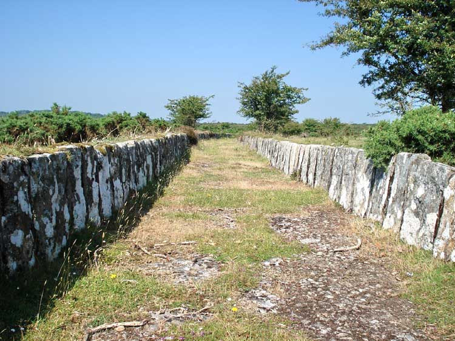

- Drake's Leat is also known as Plymouth Leat.
- It runs 17.5 miles (28.2km) from the River Meavy to Plymouth. Its route was determined by Mr Robert Lampen of St Budeaux who was paid 52s 5d (£2.62) to survey the possible options in 1576. The Corporation of Plymouth secured an Act of Parliament in 1585 to satisfy the desperate demand for fresh water to supply both the City and the Dockyards, although work did not start until 1590 due to costs involved with our war with Spain and the Armada.  The bill had the following clauses:
	- To provide a supply of water for naval and merchant shipping.
	- To provide water for fire fighting in Plymouth.
	- To scour [Sutton Harbour](https://en.wikipedia.org/wiki/Sutton_Harbour "Sutton Harbour") of silt.
	- To improve the poor quality of land on Dartmoor adjacent to the proposed leat.	- 
- [Dartmoor Preservation Society](https://dartmoorpreservation.co.uk/) voluntarily contribute o the upkeep and clearance of the leat.
- [Wikipedia - Drake's Leat](https://en.wikipedia.org/wiki/Drake's_Leat)

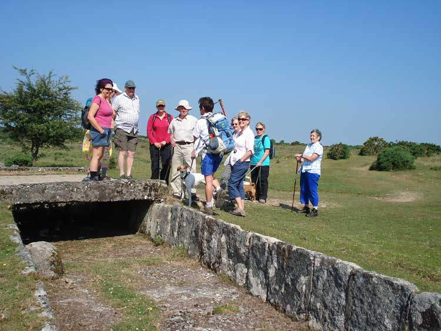

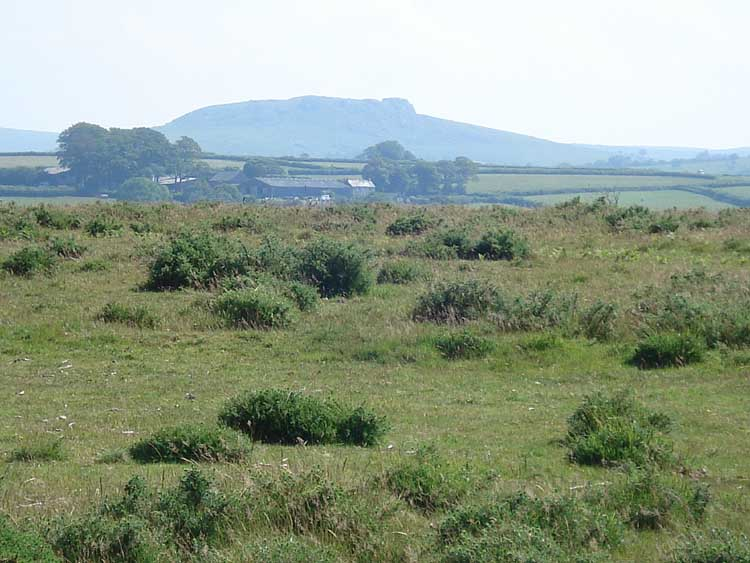

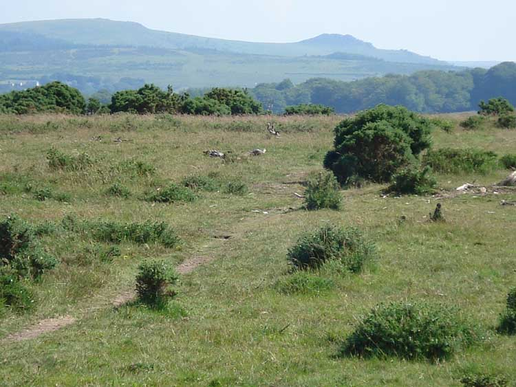

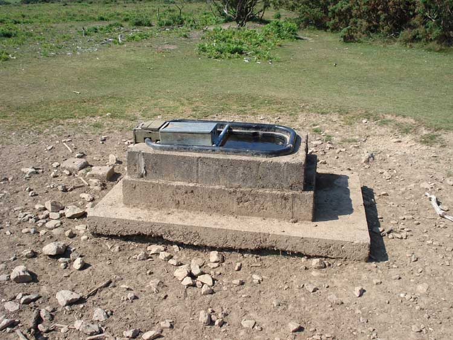

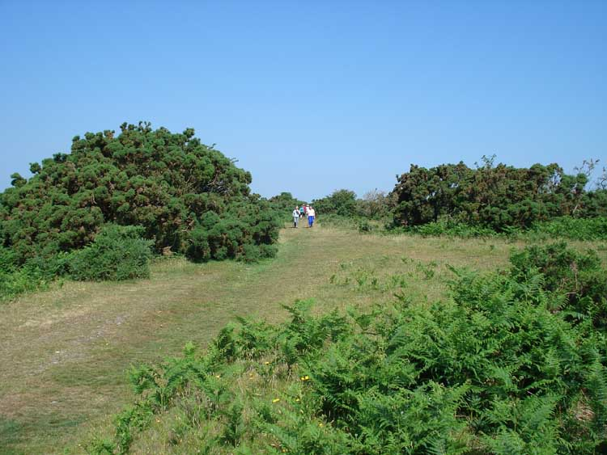

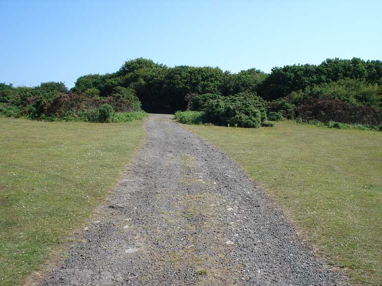

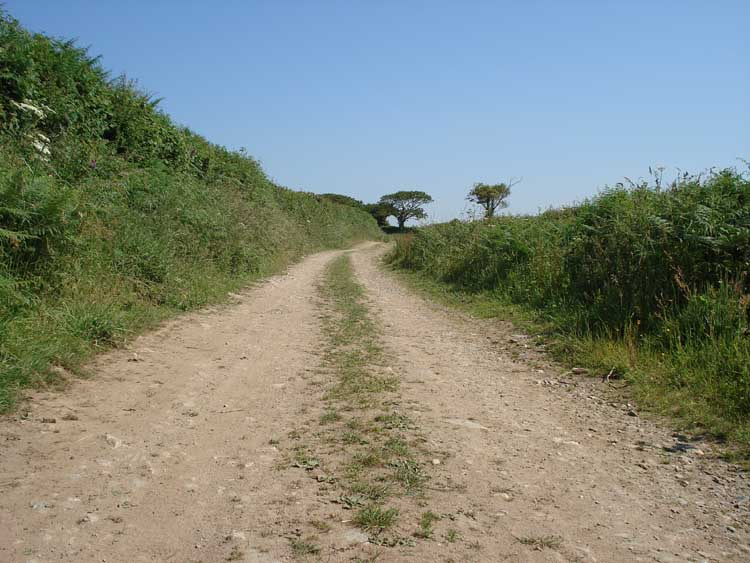

{}
After around half a mile or so, bear left to join the road running to the North of this section of the Common and follow it Eastwards down. When you come across the Railway on a bridge, cross down onto it, turning right.
{}

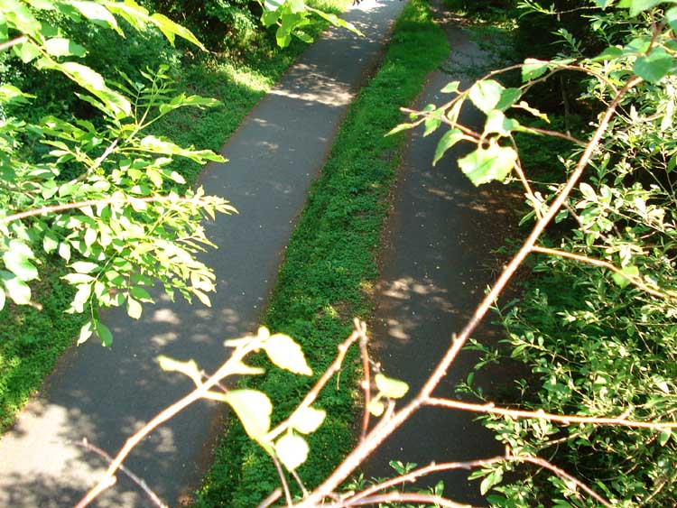

- This section of the Railway is a part of  [National Cycle Network, Route 27](https://www.walkwheelcycletrust.org.uk/find-a-route-on-the-national-cycle-network/route-27/)

## South Devon (Plymouth) -Tavistock Railway

This section of the railway was  opened in 1859 and originally of [broad gauge](https://en.wikipedia.org/wiki/Broad-gauge_railway) which could be anything *wider* than the `standard gauge` of 4ft 8.5" (1,435mm). Shortly after opening, it was adapted in 1876 to also carry `standard gauge` (also known as `narrow guage`) by adding a third rail. The British Railways were generally standardising their track gauges though, and by 1892, this section had converted fully to `standard gauge`.

[Wikipedia - South Devon (Plymouth) -Tavistock Railway](http://en.wikipedia.org/wiki/South_Devon_and_Tavistock_Railway)

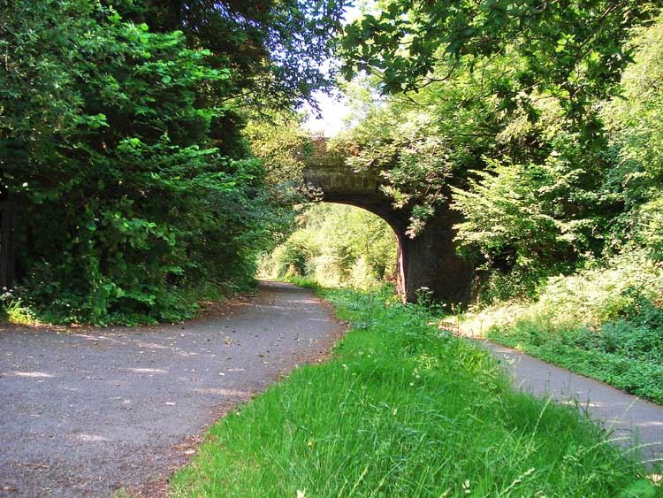

Shaugh Bridge Platform opened in 1907 and was closed at the end of 1962.

More photos, old and new, at
- [Dartmoor Explorations - Shaugh Bridge Platform](https://dartmoorexplorations.co.uk/shaugh-bridge-platform/)
- [Urban 75- Shaugh Bridge](https://www.urban75.org/photos/devon/shaugh-bridge.html)

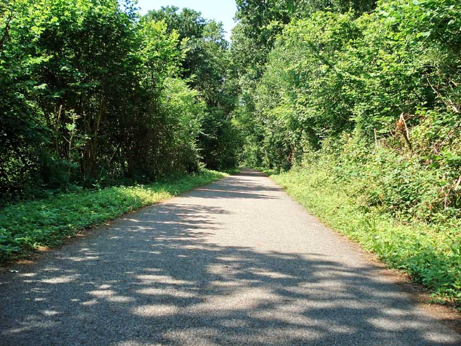

## Leighbeer Tunnel
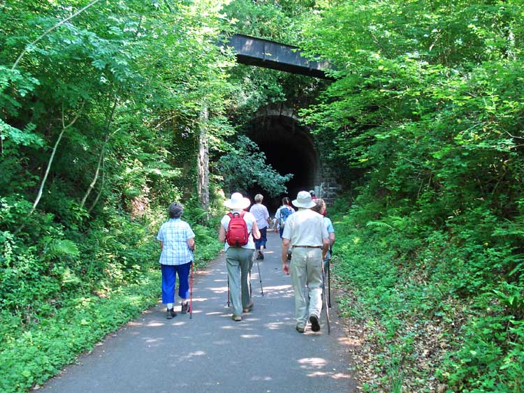

Leighbeer Tunnel, also known as "The Smokies" is 282m in length. The metal aquaduct close to the portal carries water for the Wheal Lopes leat.

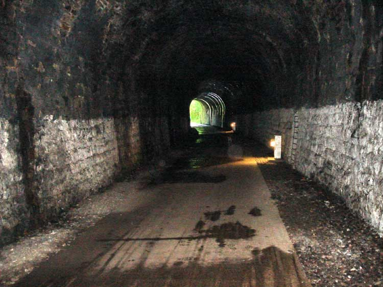

The light at the end of the tunnel, showing the lights along the way and the refuges in the sidewalls for men to shelter when trains used to run the through the tunnel - this being the old [South Devon (Plymouth) -Tavistock Railway](http://en.wikipedia.org/wiki/South_Devon_and_Tavistock_Railway), broad gauge, opened in 1859.

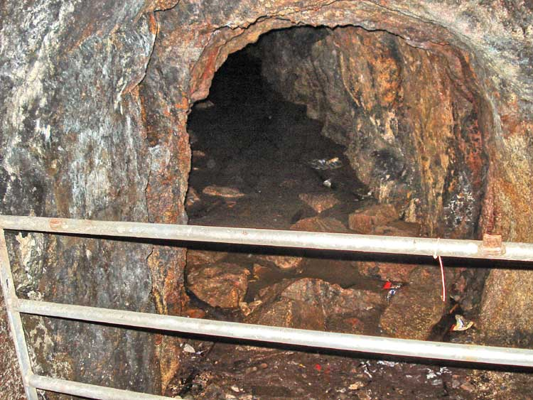

Part way along the tunnel, there is an adit.  This is part of Bickleigh Vale Phoenix Mine, also known as Leighbeer Tunnel Mine, a copper mine that may also have produced lead.

Whilst digging the tunnel, workmen discovered some copper ore and dug this short adit to explore that potential. A small company was formed and the mine opened in the same year as the tunnel, but only operated for around three years as the lode was found to be thin. 

Pictures of the adit are available 
- [28dayslater](https://www.28dayslater.co.uk/threads/bickleigh-vale-mine-leighbeer-tunnel.52027/)   and a [second report](https://www.28dayslater.co.uk/threads/bickleigh-vale-phoenix-mine-july-09.41712/) 

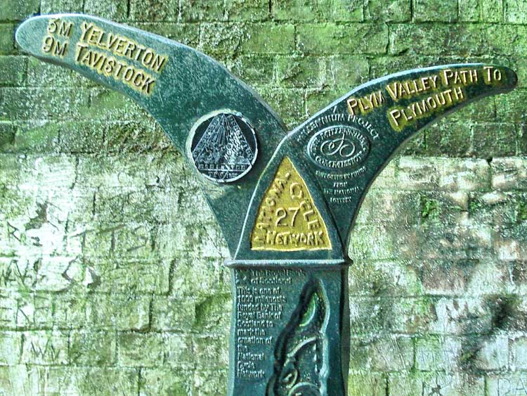

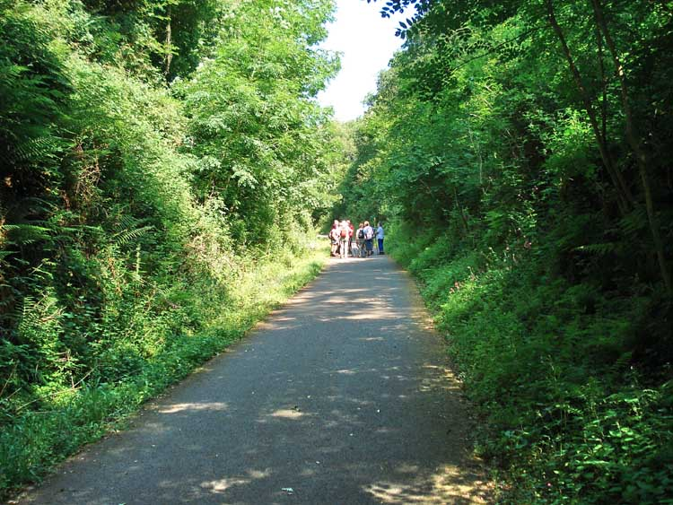

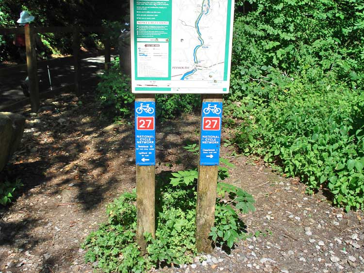

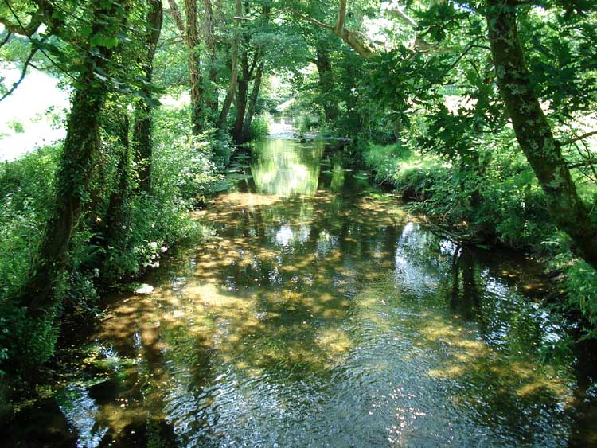

{}
Fairly soon after emerging from the tunnel, you will see a road bridge crossing over the railway. Leave the railway and enter Hele Lane just before this, then take the bridge over the railway and up the hill. After a few hundred meters, the lane bends sharply left - take the track on the right which takes you back up onto the Common. Once up there, meander along the tracks through the gorse in a vaguely North-Western direction until you return to the car park.
{}

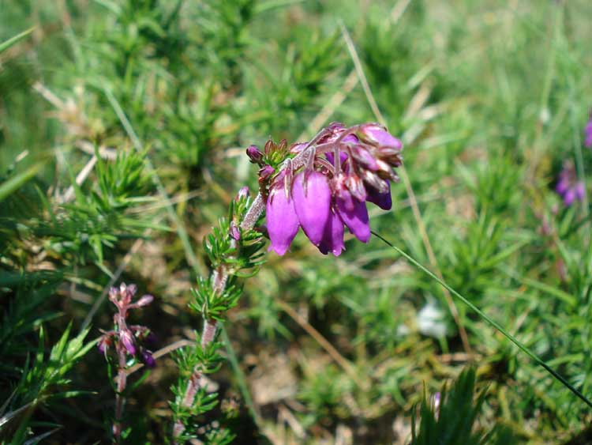

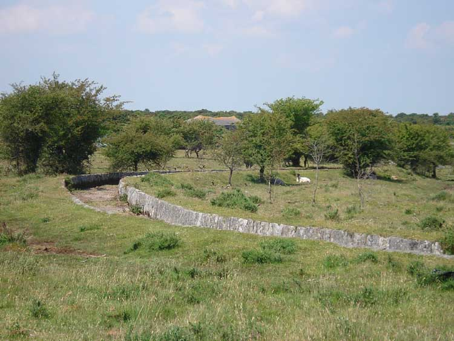

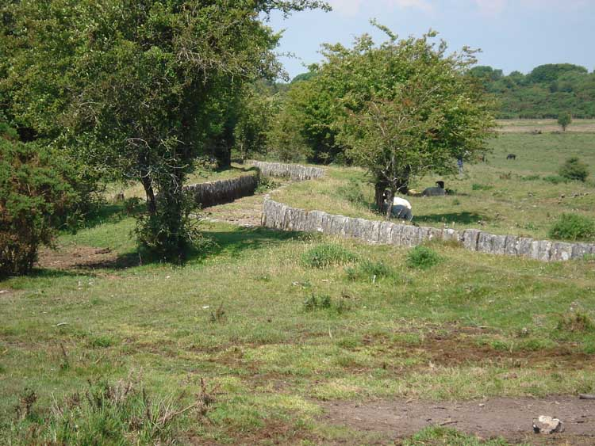

We hope you have enjoyed this walk.

## Parking

Most people would approach this from the main A386 Plymouth to Yelverton road, turning off at the sign for Clearbrook.

The posted coordinates are for a free gravel car park of a good size. There are no facilities at the start point, but the welcoming [Skylark Inn](https://www.skylarkinn.co.uk/) is very close by at Clearbrook.
If the posted car park is full, there is another a hundred meters or so down the road to the East, and a third a half mile along there which is close to our walking route.
## References


